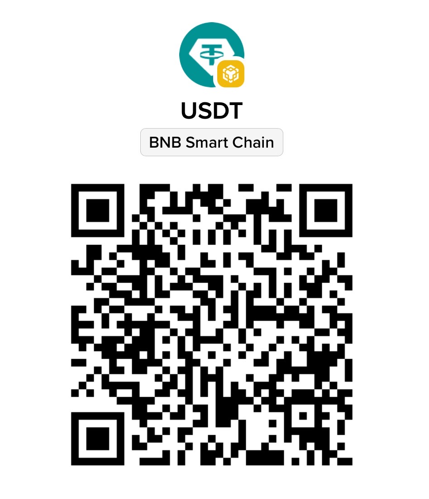
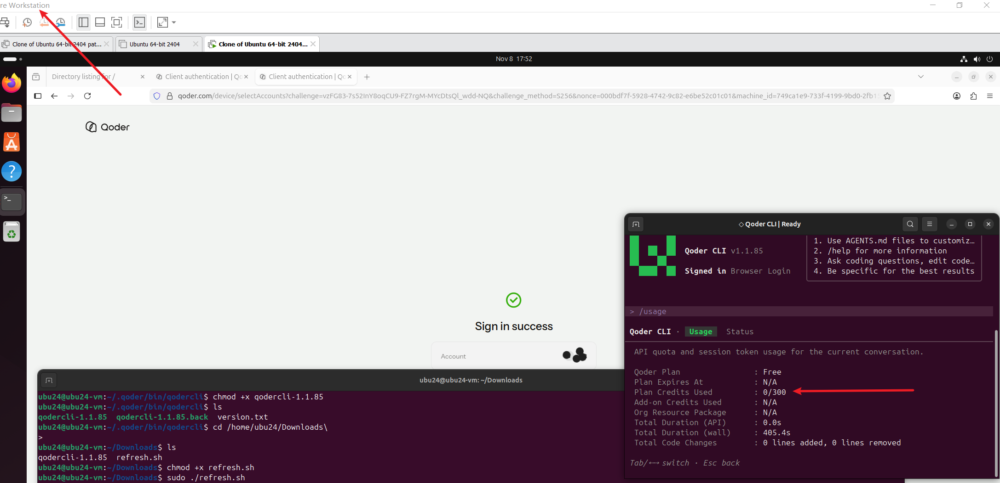
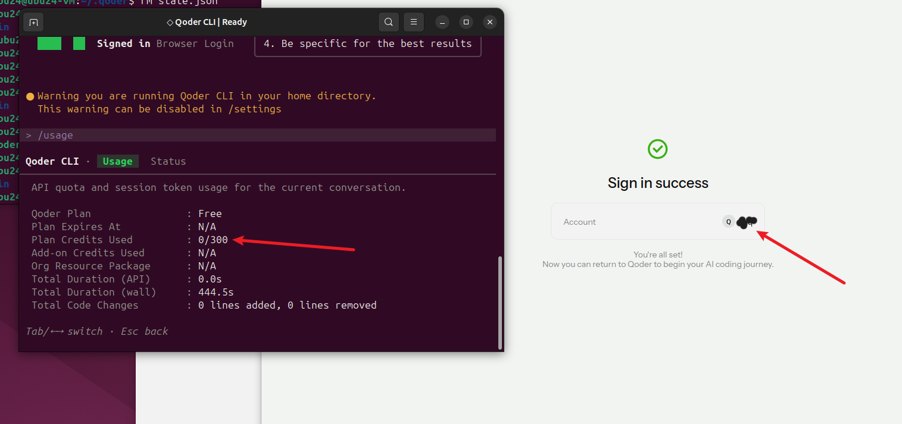

# how to use

This program is designed to bypass virtual machine (VM) and legacy device detection, enabling you to use a virtualized environment to register new email accounts and claim 300 Qoder credits for each.

Environment:
- Ubuntu 24.04 Desktop
- Qoder CLI

1. Install the Qoder CLI, then **replace the official executable with the `qodercli-1.1.85` ELF file provided in the `bins` directory.**  **！！important！！**
2. In a fresh environment, you can log in with a new account to receive the 300-credit allowance; no special steps are needed for the first attempt.
3. Clear any login traces from the `~/.qoder` directory. (Keep the `bin` directory, which contains the CLI executable; all other directories can be safely deleted.)
4. Run the `refresh` script to reset your local environment.
5. Launch the CLI, navigate to the login page, register a new account, and log in to claim your 300 credits.

Notes:
1. I am using the standard (non-China-specific) version of Qoder. Users from China, please refrain from asking questions.
2. If you fail to receive the credits, it is likely because you did not fully clear the login traces in `~/.qoder`. I recommend performing the cleanup just as the login prompt appears, before the CLI finishes its initialization.
3. The web-based login process includes a CAPTCHA. Please do not use this project for illicit profit; the goal is simply to make AI accessible to those with limited financial means—isn't that a good thing?

I have invested a significant amount of effort and personal time into building this tool. If you’d like to help make my life a little better, please consider scanning the QR code below to buy me a "Blue Tokai" coffee. Thank you so much for your support!

If you have any questions, you can reach me via email at: `IElybWFQZW5yb2RtQG91dGxvb2suY29t`

**For security reasons, I cannot provide a free solution for the latest version of Qoder—that would simply be unreasonable. As the saying goes: "Money makes the mare go; with money, you can do anything."**

**For 20 USDT, I will provide the password (please send me an email to let me know, and I will reply). For 100 USDT, I will delete this project entirely, making it yours exclusively. I will make everything fully open source in 3 months.**

# sucess cases

for test (already 300)

- `MarcelMozleypjws@outlook.com` 
- `1Outlook.com`

**⚠️ Risk Warning & Disclaimer**

THE SOFTWARE IS PROVIDED “AS IS”, WITHOUT WARRANTY OF ANY KIND, EXPRESS OR IMPLIED, INCLUDING BUT NOT LIMITED TO THE WARRANTIES OF MERCHANTABILITY, FITNESS FOR A PARTICULAR PURPOSE AND NONINFRINGEMENT. IN NO EVENT SHALL THE AUTHORS OR COPYRIGHT HOLDERS BE LIABLE FOR ANY CLAIM, DAMAGES OR OTHER LIABILITY, WHETHER IN AN ACTION OF CONTRACT, TORT OR OTHERWISE, ARISING FROM, OUT OF OR IN CONNECTION WITH THE SOFTWARE OR THE USE OR OTHER DEALINGS IN THE SOFTWARE.

**Acknowledgment of Potential Risks:**
By using this software, you acknowledge and agree that:

1. **Misuse Risk**: This software may be capable of being used in ways that violate laws or infringe upon third-party rights. You are solely responsible for ensuring that your use complies with all applicable laws and regulations.
2. **Environmental Risk**: The software may contain bugs or vulnerabilities. You are responsible for conducting thorough security testing and human review before deploying it in production, safety-critical, or high-risk environments.
3. **No Support**: The authors provide no warranty regarding the accuracy, reliability, or safety of the software, and are under no obligation to provide maintenance or support.

**You assume all risks associated with the use of this software. If you do not agree, you must cease use immediately.**

